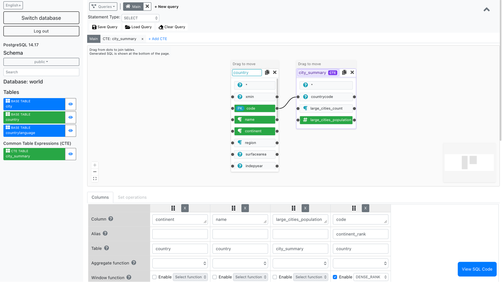
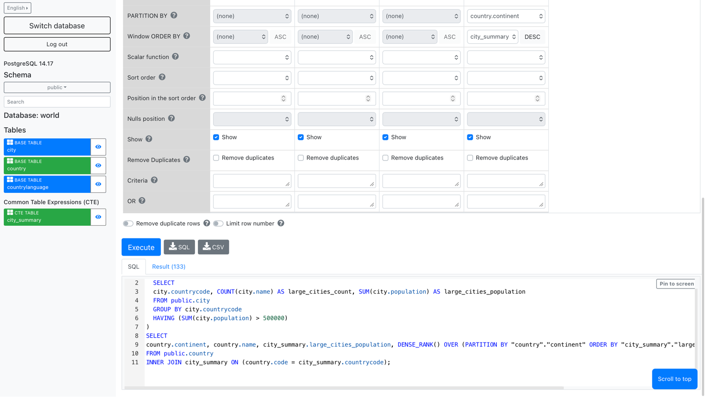

# Postgres Visual Query Builder v5

Postgres Visual Query Builder 5 is a web application for building PostgreSQL
`SELECT`, `INSERT`, `UPDATE`, and `DELETE` queries visually. It provides a
canvas-based query workspace, a generated-SQL editor, and query execution
against a connected PostgreSQL database.

## Setup

See the [Local Development Setup Guide](docs/DEVELOPMENT.md) for step-by-step
instructions to configure PostgreSQL, load the sample `world.sql` database,
and run the client and server locally.

## Functionality

### Queries

* Add/remove queries
* Change query names
* Hide/view query menu
* View queries as list
* Use queries as subqueries

### Common Table Expressions (CTEs)

* Create and edit multiple CTEs in tabs alongside the main query
* Keep each CTE's tables, columns, joins, and other query settings isolated from the main query and other CTEs
* Generate `WITH` clauses from the saved CTE workspaces, including nested CTEs
* Add a CTE as a virtual table from the sidebar and use its selected output columns in the main query or another CTE
* Prevent a CTE from being added to its own workspace
* Remove a CTE and clean up its references in the main query

### INSERT statement
* Create INSERT statements
* Add singular or multiple value rows to database
* Use subquery to insert data
* RETURNING clause on individual columns or all

### UPDATE statement
* Create UPDATE statements
* RETURNING clause on individual columns or all
* Join tables with FROM clause
* Add filter condition to column

### DELETE statement
* Create DELETE statements
* RETURNING clause on individual columns or all
* Join tables with USING clause
* Add filter condition to column

### Database

* View tables in a schema
* Switch schemas
* Search for tables

### Tables

* Add/remove tables to/from query
* Add alias to table
* Copy tables

### Columns

* Add/remove columns to/from query
* Add expressions
* Add alias to column
* Add aggregate function to column
* Add window functions (ROW_NUMBER, RANK, LAG, SUM, etc.) with PARTITION BY and ORDER BY
* Add filter condition to column
* DISTINCT ON
* ORDER BY ASC/DESC
* GROUP BY
* Change order of columns
* Copy columns
* Switch between displaying and not displaying column in query
* Limit rows
* Link subqueries to filter
* Filter grouping results
* Combine multiple filters with operators

### Join

* Join tables
* Add multiple conditions to join

### Set operations
* Add/remove set operations
* Change order of set operations
* Combine queries with UNION/UNION ALL/INTERSECT/EXCEPT set operations

### Result
 
* View built SQL
* Write queries manually or modify built SQL in editor
* Resize editor window
* Highlight matching brackets
* Syntax highlight for SQL clauses/statements
* Immediately see the number of results found
* Run the query and view the results
* Download generated SQL
* Download query results
* Delete all queries at once or one by one

### Utility

* Change the language (English, Estonian)
* Refresh the page without losing the built query
* Save built queries for later use
* Download results as CSV files

## Pictures

### Login page

### Query creation page

### CTE and window function example

## Licence

MIT
